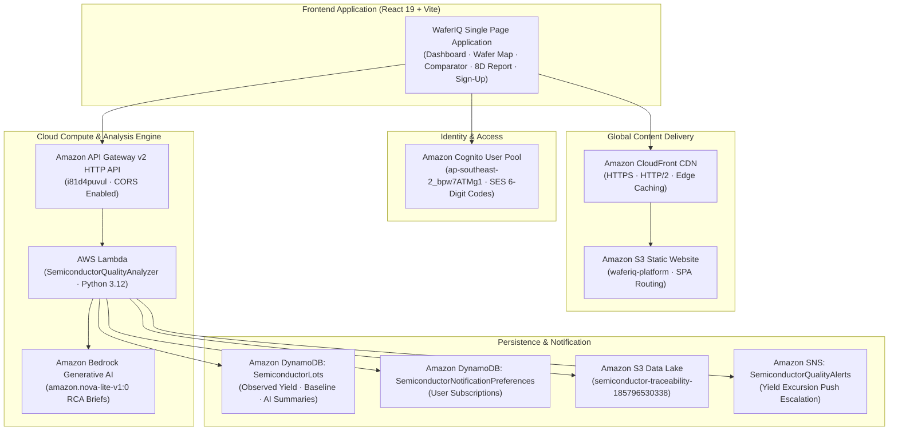

# WaferIQ — Semiconductor Yield Intelligence & Traceability Platform

[](https://d23yehd20e6q5m.cloudfront.net)
[](https://d23yehd20e6q5m.cloudfront.net)
[](https://d23yehd20e6q5m.cloudfront.net)
[](https://d23yehd20e6q5m.cloudfront.net)
[](https://d23yehd20e6q5m.cloudfront.net)

**WaferIQ** is an enterprise-grade semiconductor manufacturing yield intelligence, defect localization, and lot traceability platform. It pairs a deterministic statistical anomaly detection engine with AWS-hosted serverless APIs, Amazon Bedrock generative AI root-cause investigation synthesis, and an interactive 300mm silicon wafer inspector.

---

## 🌐 Live Production Deployments

The platform is deployed and globally accessible:

- **🔒 Official Production HTTPS (CloudFront CDN):**  
  **[https://d23yehd20e6q5m.cloudfront.net](https://d23yehd20e6q5m.cloudfront.net)**  
  *(HTTP/2, SSL encryption, global edge caching, and automated SPA routing fallback).*

- **🏷️ Branded Static S3 Website:**  
  **[http://waferiq-platform.s3-website-ap-southeast-2.amazonaws.com](http://waferiq-platform.s3-website-ap-southeast-2.amazonaws.com)**

### Direct Sub-Routes:
- **Sign-Up Console:** [`/signup`](https://d23yehd20e6q5m.cloudfront.net/signup) — Self-service Cognito registration with real-time password compliance & 6-digit confirmation code.
- **Side-by-Side Lot Comparator:** [`/compare`](https://d23yehd20e6q5m.cloudfront.net/compare) — Excursion vs. reference lot diagnostics with yield delta banner.
- **Silicon Wafer Inspector:** [`/lots/LOT-7821`](https://d23yehd20e6q5m.cloudfront.net/lots/LOT-7821) — 300mm SVG map with Concentric Radial Zones (Center, Middle, Bevel Edge).
- **Investigation Center & 8D:** [`/investigations`](https://d23yehd20e6q5m.cloudfront.net/investigations) — Quality CAPA triage with one-click **Download 8D `.MD`** & Print/PDF export.
- **Anomaly Model Lab:** [`/model-lab`](https://d23yehd20e6q5m.cloudfront.net/model-lab) — Detection threshold sensitivity and synthetic cohort benchmarks.

---

## 🏗️ System Architecture



---

## ⚡ Key Capabilities

### 1. Interactive 300mm Silicon Wafer Inspector
- **Concentric Radial Zones:** Computes yield across **Center Zone** ($r < 0.45R$), **Middle Annulus** ($0.45R \le r < 0.82R$), and **Bevel Edge Zone** ($r \ge 0.82R$) to detect spin-coat edge bead, clamp-ring thermal gradients, and CMP over-polish.
- **Interactive Die-Level Probe:** Click individual dies on the SVG grid to inspect `(row, col)` coordinates, radial ratio $r/R$, defect classification, and test bin failure codes.
- **Orientation Notch Indicator:** Real-time alignment reference matching standard SEMI M1 wafer geometry.

### 2. Side-by-Side Diagnostic Lot Comparator (`/compare`)
- Compare any target excursion lot against a nominal baseline reference lot.
- **Yield Delta Banner:** Real-time calculation of percentage-point yield differential ($\Delta \text{ Yield}$) and scrap die differential.
- **Synchronized Visuals:** Dual side-by-side yield gauges, 300mm wafer maps, and defect Pareto distributions.
- **1-Click Swap:** `⇄ Swap Lots` button for immediate reference-reversal analysis.

### 3. Automotive 8D Problem Solving Dossier (CAPA Standard)
- Generates industry-standard **8D Incident Reports** (Disciplines D1 through D8) conforming to semiconductor and automotive (IATF 16949 / AEC-Q100) CAPA requirements.
- Automatically compiles problem descriptions, observed vs. baseline yield, Bedrock AI root-cause briefs, and corrective action plans.
- **Export Options:** 1-click **Download `.MD`** (`8D-Report-<LOT>.md`) and browser **Print / Save as PDF** support.

### 4. Self-Service Amazon Cognito Authentication (`/signup` & `/login`)
- Connected directly to Amazon Cognito User Pool `ap-southeast-2_bpw7ATMg1`.
- **Live 5-Rule Password Policy Validator:** Dynamic real-time validation (8+ characters, uppercase, lowercase, numbers, password confirmation match).
- **2-Step Verification:** 6-digit confirmation code delivery via Amazon SES with resend capability.
- **User Session Persistence:** Local session caching and sign-out controls.

### 5. Automated Test Equipment (ATE) File Ingestion & Presets
- Drag-and-drop file ingestion zone accepting `.csv` and `.json` tester data runs.
- **1-Click Test Presets:**
  - `⚡ Excursion (88.5%)` — Injected yield-drop scenario on `TESTER-03`.
  - `⚡ Nominal (98.2%)` — Healthy baseline run on `TESTER-01`.
  - `⚡ Probe Wear (89.2%)` — High contact resistance signature on `TESTER-02`.
- Bundled sample test CSV files in `frontend-react/public/sample_ate/`.

### 6. Amazon Bedrock Generative AI Investigator
- Real-time synthesis of root-cause hypotheses using **Amazon Bedrock Nova (`amazon.nova-lite-v1:0`)**.
- Cross-references equipment calibration, recipe revisions, and comparison cohorts.
- Transparent responsible AI disclaimer: AI guidance is provided for engineering review and does not establish a legally binding root cause.

---

## 💻 Technology Stack

| Layer | Technologies |
| :--- | :--- |
| **Frontend Framework** | React 19, React Router 7, Vite 8 |
| **Authentication SDK** | Amazon Cognito Identity Browser SDK |
| **Styling & Icons** | Custom Semiconductor Design System (Dark Mode), SVG Icon System |
| **Cloud Hosting** | Amazon CloudFront (Global CDN, HTTPS, HTTP/2), Amazon S3 (Static Website Hosting) |
| **API & Compute** | Amazon API Gateway v2 (HTTP API, CORS enabled), AWS Lambda (Python 3.12) |
| **Generative AI** | Amazon Bedrock Runtime (`amazon.nova-lite-v1:0`) |
| **Persistence** | Amazon DynamoDB (`SemiconductorLots`, `SemiconductorNotificationPreferences`), Amazon S3 |
| **Notifications** | Amazon SNS (`SemiconductorQualityAlerts`), Amazon SES |
| **Code Quality** | Oxlint (0 errors, 0 warnings), Python `unittest` (23 unit tests) |

---

## 🛠️ Run Locally & Development

### Prerequisites
- Node.js $\ge 20$ (Node v22 recommended)
- Python $\ge 3.10$ (Python 3.12 recommended)
- AWS CLI v2 (for deployment operations)

### 1. Run the Modern React Application
```bash
cd frontend-react
npm install
npm run dev
```
Open **`http://localhost:5173`** in your browser.

### 2. Verify Linting & Build
```bash
# Run ultra-fast oxlint
cd frontend-react
npx oxlint

# Run Vite production build
npm run build
```
*(Or run the all-in-one automation script: `bash scripts/build_frontend.sh`)*.

### 3. Run Backend Unit Tests (23 Tests)
From the repository root:
```bash
python3 -m unittest discover -s backend/tests -v
```

### 4. Run Synthetic Benchmark Evaluation
```bash
python3 scripts/evaluate_detector.py
```
Outputs are generated in `build/evaluation/` (`evaluation_report.md`, `threshold_metrics.csv`, `lot_predictions.csv`).

---

## 📊 Benchmark Evaluation Results

The detector was evaluated across 60 synthetic manufacturing lots (54 nominal lots, 6 injected yield-drop anomalies):

| Alert Threshold (pp) | True Positives | False Positives | False Negatives | Precision | Recall | F1 Score | Determination |
| :---: | :---: | :---: | :---: | :---: | :---: | :---: | :--- |
| **3.0 pp** | 6 | 0 | 0 | 1.00 | 1.00 | 1.00 | Sensitive |
| **5.0 pp (Default)** | **6** | **0** | **0** | **1.00** | **1.00** | **1.00** | **Optimal Baseline** |
| **7.0 pp** | 3 | 0 | 3 | 1.00 | 0.50 | 0.67 | Under-detecting |
| **10.0 pp** | 0 | 0 | 6 | 0.00 | 0.00 | 0.00 | Ineffective |

> *Note: Benchmarks represent synthetic evaluation datasets designed for deterministic validation of the anomaly engine. Synthetic sample data is clearly tagged with "SYNTHETIC BENCHMARK DATA" in the UI.*

---

## 📁 Repository Structure

```text
├── backend/
│   ├── lambda_functions/     # AWS Lambda handler (API Gateway routing & DynamoDB/S3 persistence)
│   ├── quality_engine/       # Deterministic anomaly detector, lot metrics, and models
│   └── tests/                # 23 Python unit tests
├── frontend-react/           # Modern React 19 + Vite Semiconductor Application
│   ├── public/
│   │   ├── sample_ate/       # Downloadable sample ATE CSV test runs
│   │   └── vendor/           # Amazon Cognito Identity browser bundle
│   └── src/
│       ├── components/       # WaferMap, LotComparator, EightDReportModal, SignUpConsole, etc.
│       ├── data/             # Benchmark lot datasets and constants
│       └── services/         # API client & Amazon Cognito authentication service
├── frontend/                 # Preserved legacy vanilla-JS dashboard (index.html)
├── sample_data/              # Synthetic lot records and scenario definitions
├── scripts/
│   ├── build_frontend.sh     # Linter & Vite build pipeline
│   ├── create_cloudfront.py  # Amazon CloudFront distribution provisioning
│   ├── create_waferiq_platform_bucket.py # S3 bucket provisioning
│   ├── deploy_s3.py          # S3 sync deployment utility
│   ├── configure_api_gateway.py # API Gateway CORS configuration utility
│   ├── test_live_api.py      # End-to-end API & Bedrock test runner
│   ├── evaluate_detector.py  # Anomaly detector evaluation script
│   └── generate_dataset.py   # Synthetic lot dataset generator
└── docs/                     # Project architecture documentation
```

---

## 🔒 Security & Compliance

- **No Secrets in Code:** Zero hardcoded API keys, tokens, or IAM credentials.
- **Client-Side Auth:** Amazon Cognito user pools manage identity with SRP (Secure Remote Password) protocol.
- **CORS Protection:** API Gateway configured with explicit allowed origins, headers, and HTTP methods.
- **Responsible AI Disclaimer:** Generative AI output is explicitly labeled as preliminary guidance for engineering triage and does not substitute for physical failure analysis (FA).

---

## 📜 License & Credits

Developed as part of the **WaferIQ Semiconductor Traceability & Quality Intelligence Project**.
All synthetic benchmark datasets are generated for platform evaluation.
